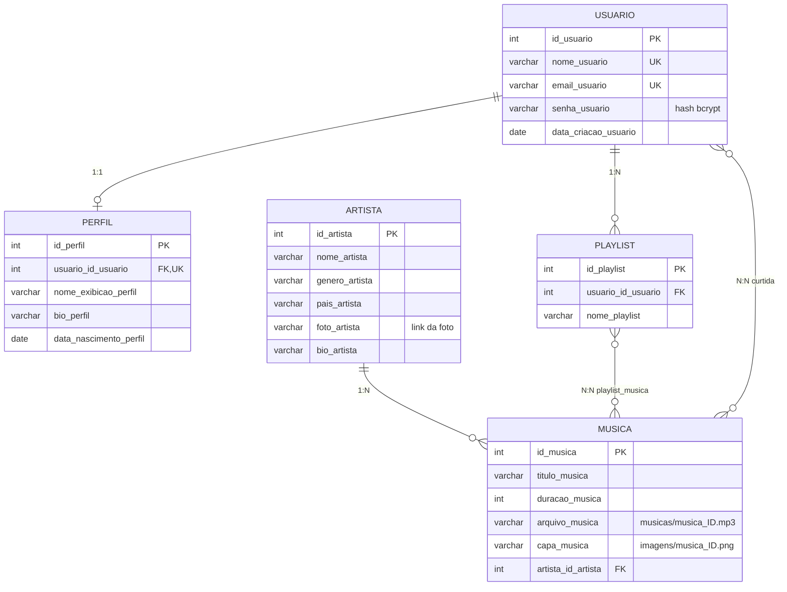

# 🎧 SpotifyFake — DW1 · 4º Bimestre 2026

**Autor:** Matheus Dziubate · **Turma:** M32 · **Ano:** 2026

Player de músicas com **cadastro e login (cookies)**, duas visões (**usuário** e **administrador**) e **upload de músicas** (MP3 + capa) pelo painel admin. O que o admin envia aparece para os usuários em poucos segundos, sem recarregar a página.

**Player estilo Spotify:** aba **Buscar** (acha músicas e artistas pelo que você escreve, mesmo com erro de digitação), **perfil do artista** (foto, gênero, país e músicas), **playlists** de cada usuário, **músicas curtidas** (❤), botões de **próxima / anterior / aleatório / repetir**, barra de progresso e volume.

Evolução do projeto: 2º bimestre (front: login + player) → 3º bimestre (back: Express + PostgreSQL + CRUDs) → **4º bimestre (login com cookies, núcleo do sistema e visão admin)**.

## Tecnologias
Node.js · Express · PostgreSQL (`pg`, sem ORM) · `bcryptjs` (hash de senha) · `cookie-parser` (cookie assinado) · `multer` (upload) · `sharp` (capa 300x300 PNG) · HTML5 / CSS3 / JavaScript puro.

## Como funciona

| Quem | Como entra | O que vê |
|---|---|---|
| Visitante | `/frontend/login/login.html` ou `/frontend/cadastro/cadastro.html` | Só login e cadastro |
| Usuário | Login com nome (ou e-mail) + senha | **Player**: escolhe e ouve as músicas |
| Admin (usuário `admin`) | Login → janela **"Como você quer entrar?"** | **Entrar como usuário** → Player · **Entrar como admin** → Painel admin |

- O **único administrador é o usuário `admin`** (o nome `admin` não pode ser cadastrado por outras pessoas).
- O login cria o cookie `sessao` (assinado, `httpOnly`). O servidor confere o cookie em cada rota: sem login → 401; rota de admin sem estar no modo admin → 403.
- **Painel admin → Músicas:** informa **nome da música + nome do artista + MP3 + capa** e salva. O MP3 e a capa podem ser **enviados como arquivo ou informados por link** (`http://`/`https://`; o link do MP3 precisa apontar direto para o arquivo `.mp3`). Se enviar arquivo e link, vale o arquivo. A foto do **perfil** também aceita link. Se o artista ainda não existe, ele é criado. Também dá para **editar** e **remover** (os arquivos são apagados junto).
- **Player** (`frontend/player/player.html`, uma página só com abas pelo `#` do endereço): a música continua tocando enquanto você troca de aba. Atualiza sozinho a cada 15 s (músicas novas aparecem, removidas somem).
  - **Início:** artistas e todas as músicas · **Buscar:** campo de pesquisa com "melhor resultado", músicas e artistas · **Artista:** perfil com foto e músicas · **Músicas curtidas** · **Playlists** (criar, renomear, excluir, adicionar e remover músicas pelo menu ⋯ de cada música).
  - **Busca:** ignora acentos e maiúsculas, aceita só o começo do nome e perdoa erros de digitação (ex.: `bilie ailish` → Billie Eilish). Ela procura em **título e artista**, não dentro da letra das músicas.
  - **Teclado:** barra de espaço toca/pausa.
- Demais CRUDs do admin (3º bimestre): Usuários, Perfis (com foto) e Artistas. As listas de **músicas, usuários e perfis** mostram a foto de cada registro (silhueta quando não há foto).
- **Plano Premium** (`frontend/pagamento/pagamento.html`, link "Premium" no player): tela de pagamento **simulada** (planos + cartão/Pix/boleto). Nada é cobrado, enviado ou salvo. Ao escolher **Pix** e clicar em *Gerar QR Code Pix*, a tela mostra um **QR Code** e o código **"copia e cola"** (padrão BR Code do Banco Central, com CRC16), gerados no próprio navegador com a biblioteca `qrcode-generator` (MIT, arquivo `frontend/pagamento/qrcode.js`). A chave Pix é **fictícia** (constante `PIX_DEMO` no começo do `pagamento.js`): o QR lê normalmente, mas o banco não acha o destinatário e nada é cobrado.

## Como rodar

1. Instale o [Node.js](https://nodejs.org) e o PostgreSQL.
2. Crie o banco `spotifyfake` e execute o script **`documentacao/spotifyfake.sql`** (cria as tabelas e a carga inicial; recria as tabelas se já existirem).
   - **Já tinha o banco criado?** Em vez de recriar, rode só **`documentacao/migracao_player.sql`** (não apaga nada; cria as tabelas de curtidas/playlists e as colunas de foto/bio do artista).
3. Copie `backend/.env.example` para `backend/.env` e ajuste a senha do seu PostgreSQL (e o `SESSION_SECRET`). O `.env` precisa ter estas variáveis (ele não vai para o GitHub):
   ```
   DB_HOST=localhost
   DB_PORT=5432
   DB_USER=postgres
   DB_PASSWORD=sua_senha_do_postgres
   DB_NAME=spotifyfake
   PORT=3001
   SESSION_SECRET=uma_frase_qualquer
   JAMENDO_CLIENT_ID=      (opcional, só para npm run popular:jamendo)
   ```
4. Na raiz do projeto:
   ```bash
   npm install
   npm start
   ```
5. **Encher o catálogo** (artistas, músicas e fotos): com o servidor parado ou ligado, em outro terminal na raiz do projeto, rode `npm run popular` (precisa de internet e Node 18+). Leva uns 2 minutos e pode ser repetido sem duplicar nada. Veja a seção *Catálogo de músicas* abaixo.
6. Abra **http://localhost:3001** (o servidor também entrega o front-end; não use o Live Server, porque o cookie de login depende de abrir o site pelo próprio servidor).

**Logins de teste:** `admin` / `1234` · demais usuários (ex.: `Maria Souza`) / `123456` · ou crie o seu em *Cadastre-se*.

> **Banco já criado?** Para aceitar links longos, rode: `ALTER TABLE public.musica ALTER COLUMN arquivo_musica TYPE VARCHAR(500), ALTER COLUMN capa_musica TYPE VARCHAR(500); ALTER TABLE public.perfil ALTER COLUMN foto_perfil TYPE VARCHAR(500);` (ou recrie com o `spotifyfake.sql`).

## Catálogo de músicas (`npm run popular`)

O script `backend/scripts/popular.js` cadastra ~28 artistas e até 6 músicas de cada, guardando **só links** no banco (nada é baixado):

- **Músicas e capas:** iTunes Search API (gratuita, sem chave). O áudio é a **prévia de 30 segundos** que a Apple libera para divulgação, então essas músicas tocam 30 s (as músicas inteiras que você enviou pelo admin continuam tocando inteiras). Por isso a duração gravada é 30 s.
- **Fotos dos artistas:** Deezer API (gratuita, sem chave). Artistas que já existiam (ex.: Billie Eilish) só ganham a foto.
- Se a rede da escola bloquear `itunes.apple.com` ou `api.deezer.com`, o script avisa e o player segue funcionando com as músicas que já estão no banco.
- Para trocar a lista de artistas, edite o array `ARTISTAS` no começo do arquivo.

### Músicas inteiras e grátis (`npm run popular:jamendo`)
O Jamendo (jamendo.com) tem músicas independentes em Creative Commons, **completas**. Crie uma conta e um aplicativo em **devportal.jamendo.com**, copie o *Client ID* e coloque no `backend/.env`: `JAMENDO_CLIENT_ID=...`. Depois rode `npm run popular:jamendo`. O script importa ~12 gêneros (até 15 artistas diferentes cada), guardando só links. Só entram músicas em que o artista liberou o download (`audiodownload`), porque o campo `audio` do Jamendo costuma ser só uma prévia. Rodar de novo corrige links antigos de prévia; `node backend/scripts/popular_jamendo.js --limpar` apaga as que continuaram só com prévia. As músicas pedem crédito ao artista (a bio de cada um diz que é do Jamendo).

### Foto do artista
Em **Admin → Artistas** a foto pode ser um **arquivo** (clique na imagem; ela é cortada em 500×500 e salva em `imagens/artista_ID_….png`) ou um **link**. Ao trocar a foto ou excluir o artista, o arquivo antigo é apagado.

## Banco de dados



- Tabelas independentes: `usuario` e `artista` · 1:1: `usuario`–`perfil` · 1:N: `artista`–`musica` e `usuario`–`playlist` · N:N: `curtida` (usuário–música) e `playlist_musica` (playlist–música). Apagar uma música, usuário ou playlist apaga também as curtidas/ligações dela (`ON DELETE CASCADE`).
- Carga inicial com **mais de 10 registros por tabela** (as 10 músicas já vêm com MP3 e capa).
- Senhas salvas com **bcrypt**, nunca em texto puro.

## Estrutura

```
backend/        server.js, database.js, routes/, controllers/, middlewares/ (auth), scripts/popular.js, .env.example
frontend/       login/ cadastro/ player/ (app.css + player.js) pagamento/ (usuário) · menu/ usuario/ perfil/ artista/ musica/ (admin)
imagens/        logo.png, capas e fotos (musica_ID.png, perfil_ID.png)
musicas/        arquivos MP3 (musica_ID.mp3)
documentacao/   spotifyfake.sql, migracao_player.sql
```

## Principais rotas

| Rota | Acesso |
|---|---|
| `POST /usuario/cadastro` · `POST /login` · `POST /login/logout` | público |
| `GET /login/me` · `GET /musica/listar` | logado |
| `GET /catalogo/artistas` · `GET /catalogo/busca?q=texto` | logado |
| `GET /curtida/listar` · `POST /curtida/:idMusica` · `DELETE /curtida/:idMusica` | logado (cada um vê só as suas) |
| `GET /playlist/listar` · `GET/PUT/DELETE /playlist/:id` · `POST /playlist` · `POST /playlist/:id/musica` · `DELETE /playlist/:id/musica/:idMusica` | logado (só o dono da playlist) |
| `POST /login/modo` | logado (só o admin pode escolher `admin`) |
| `POST/PUT/DELETE /musica` (upload MP3 + capa) · CRUDs de `/usuario`, `/perfil`, `/artista` | admin (modo admin) |

## Observações
- As músicas iniciais com "Artista não informado" podem ser corrigidas em **Admin → Músicas → Editar**.
- Segurança: as listas do admin são montadas com `textContent`/DOM (sem `innerHTML` com dados do banco), evitando XSS; o servidor só aceita links `http`/`https`.
- Limite de upload: 30 MB por arquivo. O servidor confere se o arquivo é mesmo um MP3 e se a capa é uma imagem.

## Popular o banco

Na pasta principal do projeto (onde fica o `package.json`), depois de `npm install` e de configurar o `backend/.env`:

```
node backend/scripts/popular.js
node backend/scripts/popular_jamendo.js
node backend/scripts/popular_jamendo.js --com-previa
```

- `popular.js`: artistas famosos com foto. As músicas tocam só **30 segundos** (prévias do iTunes).
- `popular_jamendo.js`: músicas **inteiras** de artistas independentes. Precisa de `JAMENDO_CLIENT_ID` no `backend/.env`.
- `--com-previa`: só use se o comando anterior não trouxe músicas. Ele completa com prévias de 30 segundos.
- Todos podem ser rodados de novo sem duplicar nada. **Não use `--limpar`**, que apaga músicas.

## Relatório de aprendizagem de DW1

> **PREENCHER com as suas palavras (de 1 a 3 páginas).** Tópicos pedidos pelo professor: fale sobre o seu projeto e os conhecimentos adquiridos; o que você fez, as dificuldades que teve e como as superou; o que esperava do projeto e o que conseguiu entregar; suas experiências com uso de IA (o que foi mais fácil ou importante); e a sua preferência entre backend e frontend.

### Meu projeto e o que aprendi
(escreva aqui)

### Dificuldades e como superei
(escreva aqui)

### O que eu esperava x o que entreguei
(escreva aqui)

### Experiência com IA
(escreva aqui)

### Backend ou frontend?
(escreva aqui)
